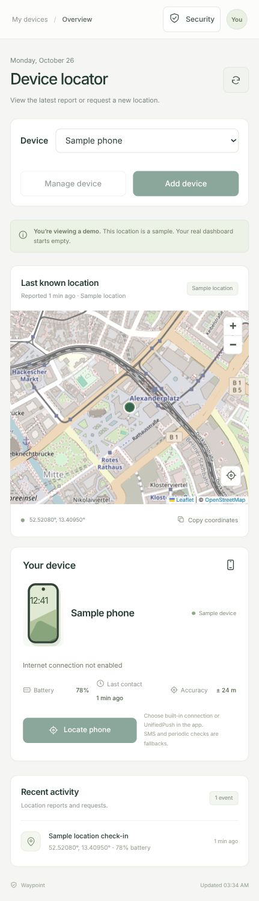
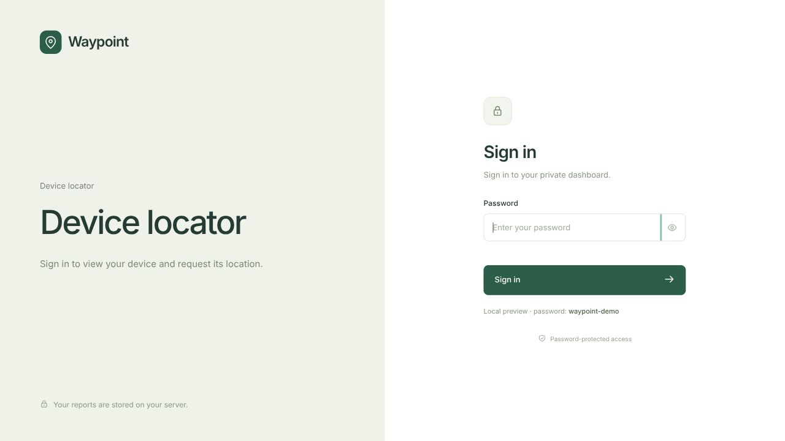

# Waypoint

Self-hosted Android device locator with a web dashboard. Uses Google-free Android location APIs with a choice of built-in internet connection or UnifiedPush. SMS and optional scheduled checks provide alternative transports.

> **Under active development and testing.** Waypoint is experimental. Background delivery, reboot recovery, location accuracy, and battery consumption are still being tested across devices and networks. Features and configuration may change. Do not rely on it as your only way to recover a lost phone. It has not undergone an independent security audit.

**Contributions are welcome:** code, bug reports, documentation, translations, and testing on other Android devices. See [Contributing](CONTRIBUTING.md).

## Screenshots

These screenshots use the local demo with a synthetic device and sample coordinates, not a real phone report. Screens may change during development.



<details>
<summary>Sign-in screen</summary>



</details>

## How it works

1. Press **Locate phone** in the dashboard.
2. The server queues a command and sends a wake-up over your selected transport.
3. The built-in authenticated WebSocket connection receives it directly, or your UnifiedPush distributor wakes Waypoint.
4. Waypoint authenticates to your server, fetches the pending command, acquires a location, and uploads the result.
5. The location service stops after completion or a bounded attempt.

The push provider receives an encrypted wake-up payload. Device credentials, location, and command details are exchanged directly with your server over HTTPS. The server can read location reports; this project does not implement end-to-end encryption of stored location history.

This transport design follows the approach documented by [FMD](https://fmd-foss.org/docs/fmd-android/push/). Waypoint is an independent implementation and uses its own server protocol.

## Requirements

- Android 12 or newer; location enabled.
- Built-in mode needs no extra app. UnifiedPush mode optionally uses a distributor such as **ntfy** or **Sunup**. Allow background activity for the selected listener.
- Docker / Docker Compose on a server, with a persistent volume and HTTPS reverse proxy.
- One owner dashboard account per server instance, with up to 20 active Android devices. Each device has separate credentials, commands, reports, and wake-up connections.

**Cloudflare, Dokploy, Google Play services, and a specific phone model are not required.**

## Server setup

From a checkout, use Node.js 24+ to generate configuration:

```sh
node scripts/setup.mjs --origin https://locator.example.com --device "My phone"
docker compose up -d --build
```

The generator writes `.env` and `credentials.txt` with private file permissions. These files are ignored by Git. Open `credentials.txt` locally for the dashboard password and Android device token. Use the **device token**, not the dashboard password, in the Android app. The initial token creates the first device; add further devices in the dashboard.

The default Compose setup binds HTTP to `127.0.0.1:8080`. Configure your existing HTTPS reverse proxy to forward to that address. Set `APP_ORIGIN` to the exact external HTTPS origin, without a trailing slash.

### Caddy HTTPS (recommended for a simple public deployment)

Point a domain at the server, add `DOMAIN=locator.example.com` to `.env`, then run:

```sh
docker compose -f compose.yaml -f deploy/compose.caddy.yaml up -d --build
```

Caddy obtains a certificate and proxies requests to the application. Ports 80 and 443 must be available. No Cloudflare account is needed.

### Dokploy or another container platform

Build from `server/Dockerfile`, with **server/** as build context. Set the variables from `.env` in the platform, mount a persistent volume at `/app/data`, and route to container port **3000**. Use one replica. Logs, environment settings, restarts, and deployment remain under your platform’s control.

### Optional Cloudflare Access

You may place a Tunnel and Access policy in front of the dashboard, but they are optional. Native Android requests must also pass your proxy. For Cloudflare Access, add a Service Auth policy and put its service token ID/secret in the Android app’s **optional Cloudflare Access settings**. Other reverse proxies need no Cloudflare headers. Do not use an interactive login page as the only route to `/api/device/*`.

## Android setup

Build from `android/`, or install an APK built from the source:

```sh
gradle -p android assembleDebug
adb install -r android/app/build/outputs/apk/debug/app-debug.apk
```

1. Open Waypoint → **Connection** card → **Edit**.
2. Enter your server’s HTTPS origin and device token from `credentials.txt`.
3. Grant precise location, background location (**Allow all the time**), and notification permissions.
4. Choose **Built-in connection** and connect, or install/configure a distributor and choose **UnifiedPush distributor**. Allow background activity for Waypoint, and also the distributor when using UnifiedPush.
5. Confirm the connection status. Background the app, press **Locate phone**, and check that a fresh report arrives.

For better positioning while using mobile data, Android's **Location services → Location Accuracy** and **Wi-Fi scanning** can help use nearby access points without joining a Wi-Fi network. Wi-Fi scanning is a system-wide allowance, not a continuous scanning loop implemented by Waypoint. Other apps and Android may request scans, and battery impact varies. Waypoint does not silently toggle this setting. Satellite positioning can work without Wi-Fi; reception and accuracy still depend on the surroundings. Test your own phone with Wi-Fi off before relying on remote recovery.

Connection credentials and saved subscription data are encrypted with Android Keystore. They are not embedded in the APK. A new installation has no predefined server, account, or push registration.

Incoming SMS permission is needed only for the SMS fallback. The app does not need SMS history, SMS sending, contacts, camera, microphone, or device administrator access.

### Connection options

**Built-in connection** keeps a TLS WebSocket open to your own server, with a persistent listening notification. No distributor or push provider is required. It verifies the full path to the Waypoint server with a small application heartbeat every 45 seconds, reconnecting after a missing acknowledgement or a default-network change. The notification includes the last verified time. Version 1.3.3 uses this single heartbeat instead of overlapping client and server protocol pings; older clients without application heartbeats retain server pings. Heartbeats do not request GPS. Android’s mobile-radio battery estimate can be dominated by frequent connection traffic even when location requests are rare. Queued requests are sent on reconnect while still valid. Android 1.3.2 requires a server with heartbeat acknowledgement support (server 1.3.2 or newer); upgrade the server before the APK. Your reverse proxy must support WebSocket upgrades at `/api/device/socket` (Caddy and Dokploy/Traefik normally handle this automatically). Android battery controls and network sleep can still delay delivery; a persistent service does not guarantee deep-Doze delivery.

**UnifiedPush distributor** shares the distributor connection with other compatible apps. Waypoint runs its location service only when needed. Switching modes stops the previous listener. **Internet off** leaves SMS and optional scheduled checks available.

### Push provider selection

Waypoint supports the standard UnifiedPush registration and RFC8291 encrypted Web Push, including VAPID. Choose a distributor in the app. Your distributor may use a hosted push service or a self-hosted service; no provider hostname is compiled into Waypoint.

By default, push endpoints must use HTTPS and resolve to public addresses. DNS and connection-time address checks prevent requests to private services. `PUSH_ALLOWED_HOSTS` optionally limits provider hostnames. If your own push server intentionally resolves to a private address, add its exact hostname to `PUSH_PRIVATE_HOSTS`; TLS validation stays enabled. Endpoints are capability URLs and are never displayed in the dashboard.

A provider accepting a push is shown as **Push accepted by provider**, not as device delivery. Actual completion requires a phone report. Expired registrations require re-registration in the app. Failed sends leave the command queued and show fallback options.

## Devices and dashboard security

Use **Add device** to choose a name and generate unique device credentials. The dashboard asks for your password and, when enabled, your authenticator or recovery code. Copy the HTTPS server URL and token into that phone’s **Connection → Edit** screen. The token is displayed only at creation. Android reports its manufacturer and model automatically; the chosen name stays editable in **Manage device**. These hardware labels identify a device for the owner; they are not hardware attestation.

Select a device to see its own reports, battery reading, connection, and requests. **Revoke device** disables that credential immediately, disconnects its listener, removes its push subscription, and cancels pending commands. It does not affect other devices. Its history remains stored. Revoked credentials cannot be enabled again by restarting the server. A new registration gets a new token.

Open **Security → Set up two-factor authentication**, confirm your dashboard password, and scan the QR code with a compatible authenticator (or enter the setup key). Enter a current six-digit code to activate it. Save the ten recovery codes immediately; each works once with your password, and they cannot be displayed again. Keep the authenticator or a backup separately from the phone being tracked. 2FA is optional until the owner enrolls, and is enforced for all subsequent dashboard logins once enabled. Passkeys are not implemented in this release.

Enabling or disabling 2FA signs out other browsers and rotates the current session. **Sign out other browsers** is available in Security. Sessions expire after 12 hours. Password login and sensitive operations share a persistent limit of eight failed authentication attempts per 15 minutes. Location requests and wake-up retries are limited per device. Previously accepted authenticator codes cannot be replayed; wait for the next code when confirming another sensitive action.

Android uses only its device token; it never completes browser 2FA. HTTPS and built-in authentication work independently of the reverse proxy. Caddy, Cloudflare Tunnel/Access, private VPNs such as Tailscale/Headscale, and other tunnels such as Pangolin are deployment choices. An external gateway must still allow authenticated device API and WebSocket traffic. A VPN is not required. An HTTPS reverse proxy on the same server does not conceal that server’s public IP.

If the authenticator and recovery codes are both lost, someone with server filesystem access can run:

```sh
docker compose exec waypoint node scripts/reset-2fa.mjs --confirm
```

This removes dashboard 2FA and revokes all browser sessions; the password and device credentials remain unchanged. In Dokploy, use the application container terminal. Host administrators can already access this application’s stored data, so keep host access restricted.

Existing single-device installations migrate automatically and retain their original token and history. Back up before upgrading. `DEVICE_NAME` and `DEVICE_TOKEN` bootstrap the initial registration; later names are managed in the dashboard. New installations may leave `DEVICE_TOKEN` empty and add their first device after signing in.

## Other transports

- **SMS:** Press Locate, then Copy wake-up SMS. Send the signed message to the phone from another device within 10 minutes. Waypoint validates its HMAC, timestamp, and replay state, then fetches the pending command. No automatic SMS gateway is included.
- **Scheduled checks:** Optionally enable **Check server every 15 minutes** on the phone. It checks for pending commands without requesting GPS unless needed. Android can delay the schedule.
- **Manual:** Use **Check pending request** or **Send test location** in the Android app.

## Limits and privacy

An offline or powered-off phone cannot report over the internet. Android and manufacturer battery controls may delay or block background execution. Internet delivery requires either the built-in background connection or a distributor connection; there is no measured battery guarantee. Indoor positioning may fail. Android 1.3.4 seeks a fresh fix with estimated accuracy within 20 meters, or sends the best available fresh fix after 65 seconds. A rough first network fix no longer ends acquisition immediately. GPS updates stop before the upload. This can increase the time and energy of an individual location request, without adding background tracking. The reported accuracy is an estimate, not a guarantee that the phone is inside that radius. Force-stopping the app disables its background receivers until it is reopened.

The dashboard fetches map tiles from OpenStreetMap. The tile provider sees your browser’s IP and viewed map area. Replace the tile source/CSP if you require a privately hosted map. There is no analytics or automatic reverse geocoding.

The server retains the latest 100 reports per device. Back up the entire data volume, including `secrets.key`, with a SQLite-aware backup or while stopped. The key is needed to decrypt MFA secrets and device tokens used for signed SMS. Keep VAPID keys and push subscriptions in that volume across redeployments. Revoke device credentials from **Manage device**; add a replacement registration to generate a new token. Changing `ADMIN_PASSWORD_HASH` invalidates existing browser sessions at the next server start.

## Development and checks

```sh
cd server
npm ci
npm test
npm run dev
```

Local demo: http://localhost:3000, password `waypoint-demo`. Never publish demo mode. Production requires HTTPS configuration and secure cookies.

Android: JDK 17+, Android SDK 36, and Gradle 9.6+ compatible with Android Gradle Plugin 9.4.1. The included build uses the official UnifiedPush connector. Development APKs are debug-signed; use your own release signing key for distribution and retain it for updates. No signing key is included.

See [architecture and API](docs/architecture.md), [security](SECURITY.md), and [third-party notices](NOTICE).
